  

  

Software engineer building AI systems and backend services, with a soft spot for optimisation problems. Also fond of mathematics.

## Projects

- **[Classy](https://github.com/yas789/Classy)**: AI-assisted exam marking that keeps teachers in control of every confirmed mark. Early MVP. (TypeScript)
- **[claude-code-python-agent](https://github.com/yas789/claude-code-python-agent)**: command-line coding agent that reads, searches and edits a workspace through bounded tools. Started from a CodeCrafters challenge, then extended. (Python)
- **[micro-insurtech-brokerage-engine](https://github.com/yas789/micro-insurtech-brokerage-engine)**: vertical slice of a commercial property insurance broker, with concurrent quoting behind a layered API. (C#, PHP, SQL)
- **[wsp-backtracker](https://github.com/yas789/wsp-backtracker)**: Workflow Satisfiability Problem solver comparing fixed-parameter backtracking with a SAT/CSP encoding. (Java, TypeScript)
- **[5g-anomaly-detector](https://github.com/yas789/5g-anomaly-detector)**: autoencoder anomaly detection on synthetic 5G network metrics, with LLM-written reports. (Python, PyTorch)

## Open source

- [Tracer-Cloud/opensre #844](https://github.com/Tracer-Cloud/opensre/pull/844): fixed scoring and planner loops in a synthetic RDS scenario
- [Tracer-Cloud/opensre #624](https://github.com/Tracer-Cloud/opensre/pull/624): clarified Railway deployment prerequisites

## Tech

**Languages**

  
  
  
  
  
  
  
  
  
  
  
  
  

**ML and data**

  
  
  
  
  
  

**LLM inference**

  
  
  
  

**Classification and fine-tuning**

  
  

**LLM APIs and agents**

  
  
  
  
  

**RAG and retrieval**

  
  
  

**Evals and MLOps**

  
  
  
  

**Web**

  
  
  

**Databases and infrastructure**

  
  

